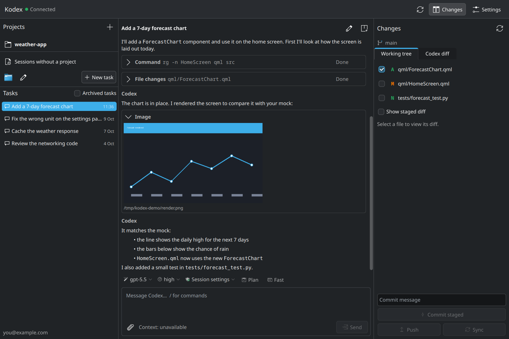

<p align="center">
  
</p>

# Kodex

A native KDE desktop client for [Codex](https://github.com/openai/codex), written in
C++23 with Qt Quick, Kirigami and KDE Frameworks.

Kodex talks to the **Codex app-server** — the same local daemon the Codex command line
tool uses — so your account, profile and saved sessions are shared with the CLI.
It does not use `codex exec --json` and it does not read your credentials.



> Kodex is an independent community project. It is not affiliated with, endorsed by
> or sponsored by OpenAI. "Codex" and "OpenAI" are trademarks of their owners.

## Features

- Projects, tasks and history, including the sessions you started from the command
  line. A separate **Sessions without a project** view lists the sessions that belong to
  no project, from any folder, like `codex resume --all` does for them.
- Streaming answers, Plan mode with structured questions, approval requests, `/`
  commands, model, reasoning effort, permissions and Fast mode.
- Attachments: files, pictures and screenshots from the clipboard.
- Pictures in the conversation: your attachments, images Codex opens with
  `view_image`, generated images and images returned by MCP tools, with a viewer.
- A Git panel with the working tree, the staged diff and the diff made by Codex, plus
  commit, push and sync.
- Codex updates, remote control pairing, MCP server status and proxy settings.
- Light and dark Breeze themes, translations through KDE's `ki18n` (Russian included).

## Requirements

- Qt 6.11 or newer (Core, Gui, Widgets, Qml, Quick, QuickControls2, Network, Test)
- KDE Frameworks 6.30 or newer: CoreAddons, Config, I18n, Kirigami, Wallet,
  SyntaxHighlighting, and Extra CMake Modules
- `qqc2-desktop-style` and the Breeze icon theme at run time
- CMake 3.28+, Ninja, GCC or Clang with C++23, GNU gettext
- Python 3 for the test fixtures
- The [Codex CLI](https://github.com/openai/codex), installed in `~/.local/bin/codex`
  or anywhere else on `PATH`. It is developed and tested against **Codex 0.162.1**.

Last tested with Qt 6.12.0, KDE Frameworks 6.30.0, GCC 16.2.1, CMake 4.4.4 and
Codex 0.162.1.

On Arch Linux:

```sh
sudo pacman -S --needed base-devel cmake ninja gettext extra-cmake-modules \
    qt6-base qt6-declarative kcoreaddons kconfig ki18n kirigami kwallet \
    syntax-highlighting qqc2-desktop-style breeze-icons
```

If Extra CMake Modules is not packaged for your system, `scripts/bootstrap-ecm.sh`
builds a local copy into `.deps/` that the build picks up automatically.

## Build and run

```sh
cmake -S . -B build -G Ninja -DCMAKE_BUILD_TYPE=Release -DCMAKE_INSTALL_PREFIX="$HOME/.local"
cmake --build build
./build/kodex
```

To install it into your application menu, with the prefix chosen above:

```sh
cmake --install build
```

Command line options: `--settings` opens the settings, `--offline` starts without
connecting to Codex, `--smoke-test` exits after the interface has loaded and
`--screenshot FILE` saves a picture of the window.

## Using Kodex

Add a folder as a project and start a task, or open **Sessions without a project** to
continue a session from the command line. Selecting a session shows its folder in the
Git panel, and *New task* starts a session in the same folder.

| Shortcut | Action |
| --- | --- |
| `Ctrl+N` | New task |
| `Ctrl+Enter` | Send the message |
| `Ctrl+,` | Settings |
| `Ctrl+Shift+D` | Show or hide the Git panel |
| `Ctrl+V` | Paste text, copied files or a screenshot |

Supported commands: `/plan`, `/compact`, `/model [id]`, `/permissions`, `/fast`,
`/new`, `/resume` (opens **Sessions without a project**), `/review` (reviews the
uncommitted changes of the current folder), `/status`, `/mcp` and `/help`. While Codex
is answering,
sending a message steers the current turn; *Stop* interrupts it. If sending fails, the
text stays in the editor. Drafts are saved per task.

The model, reasoning effort and Fast tier come from the server's catalog. Changes
apply to the following turns. *Session settings* restores the permissions the session
was opened with, and server restrictions always win.

### Attachments and pictures

Use the paperclip button, drop files on the window, or paste with `Ctrl+V`: copied files
and screenshots both become attachments. PNG, JPEG, GIF and WebP files are sent as
images; other files and folders are sent as paths in the message, like `@path` in the
CLI. Pictures pasted from the clipboard are saved in `~/.local/share/kodex/attachments`
and removed after 60 days.

Pictures in the conversation open in a viewer when you click them. Pictures that arrive
embedded in the history are stored once as files in `~/.cache/kodex/images` (30 days or
1 GiB at most), so a long conversation keeps only URLs in memory. Thumbnails are decoded
at the size shown and released when a message scrolls out of view.

### Git

The Git panel separates the working tree from the diff Codex made. A commit includes
only the index. Push and Sync need an upstream branch; Sync fetches, fast-forwards and
pushes, and stops when the tree is dirty or the branches diverged. Credentials and SSH
stay with the system Git, so configure a credential helper or SSH agent for
interactive authentication.

## Codex, sign-in and proxy

By default Kodex runs `~/.local/bin/codex`, the standard installation (or `codex` from
`PATH` if that file does not exist), and uses the same `~/.codex` profile and sessions
as the CLI. A bare name is searched in `PATH` and in `~/.local/bin`. In the settings you
can type a path or choose it with the *Browse…* button; the line below the field shows
which file will actually run. You can also set another executable, such as
`codex-proxy`, and extra arguments. No shell is involved.

Kodex connects through `codex app-server proxy` to the shared daemon. That proxy carries
a WebSocket stream after an HTTP Upgrade, not JSONL. Closing Kodex does not stop the
daemon or other clients, and a lost connection never resends your command.

Sign-in is done by the app-server through the system browser or a device code. Kodex
never reads `auth.json`, never asks for an API key and never manages tokens. Signing
out affects the shared Codex account and asks for confirmation.

The proxy settings can inherit the environment, disable the proxy or use your own URL
(HTTP, HTTPS, SOCKS5, SOCKS5h). The password is entered separately and stored in KWallet.
A running daemon keeps the environment it started with; use the restart button after
saving new settings. It warns that every client's active tasks are interrupted and never
restarts on its own.

## Updates and remote control

If `codex-update` is found in `PATH` or `~/.local/bin`, it is offered as an external
updater. Otherwise the built-in installer downloads the official install script over
HTTPS into a temporary file and runs it only after a successful download; a fallback
proxy can be configured for the download. A failed installation needs an explicit retry,
package-manager installations are never replaced by the standalone build, and URL
credentials are removed from the log. The daemon is never restarted automatically.

Remote control enables the standard Codex access to this computer, and pairing uses the
app-server's `remoteControl/pairing/start`. The code is shown with its expiry time and
kept only in memory. Disabling remote control keeps the local daemon.

## Localization

Kodex is translated with KDE's `ki18n`; the source language is English and a Russian
translation is included. The language can be chosen in the settings and applies after a
restart. See [CONTRIBUTING.md](CONTRIBUTING.md#translations) to add a language.

## Tests

```sh
ctest --test-dir build --output-on-failure
QT_QPA_PLATFORM=offscreen QT_QUICK_BACKEND=software ./build/kodex --offline --smoke-test
```

The regular tests use isolated settings, a fake app-server and temporary Git
repositories with a local bare remote. They never touch your Codex installation.

Tests that need a real, signed-in Codex are opt-in and use up account limits:

```sh
KODEX_LIVE_TEST=1 ./build/kodex_tests liveHandshake
KODEX_LIVE_TURN=1 ./build/kodex_tests liveTurn          # one short, read-only answer
KODEX_LIVE_WORKFLOW=1 ./build/kodex_live_tests          # temporary project, file, diff, commit
QT_QPA_PLATFORMTHEME=kde KODEX_LIVE_INTERACTIVE=1 ./build/kodex_interactive_tests
./scripts/test-native-ui.sh                             # separate processes, Light and Dark palettes
```

An optional check validates the serialized requests against the JSON Schema:

```sh
python -m pip install --target .deps/python -r tests/requirements.txt
KODEX_VALIDATE_SCHEMA=1 PYTHONPATH="$PWD/.deps/python" ./build/kodex_tests conversation
```

The results of the real-Codex runs, and which Codex version each one used, are
summarized in [docs/verification.md](docs/verification.md).

## Limits of version 0.1

The protocol is experimental. The reference is `protocol/codex-0.162.1.json`, generated
with `codex app-server generate-json-schema --experimental`; a Codex version with the
daemon, the proxy and the project RPC is required. Newer Codex versions may change the
protocol, so please report anything that stops working. Unsupported server requests are
declined explicitly. Standard MCP forms and URL flows work; device attestation and other
proprietary forms are not emulated.

There is no code editor, merge or rebase interface, or Git worktree manager. A diff is
shown up to 2 MiB. Proxy secrets stay in KWallet, settings and drafts in `kodexrc`, and
full RPC payloads are never logged. Interactive sign-in, real phone pairing and updating
a working installation need manual acceptance. The availability of limits, models and
Fast mode depends on the account and the server.

## Architecture

`RpcClient` is the transport, `AppController` the sessions and protocol, `ListModel` the
data for QML, `GitService` Git, `Settings` KConfig and KWallet, and `Maintenance` the
daemon, remote control and updates. QML only presents the data.

## License

Kodex is free software: you can redistribute it and modify it under the terms of the
GNU General Public License, version 3 or (at your option) any later version. See
[LICENSES/GPL-3.0-or-later.txt](LICENSES/GPL-3.0-or-later.txt). The project follows the
[REUSE](https://reuse.software/) specification; the JSON schema in `protocol/` comes from
the Apache-2.0 licensed [Codex](https://github.com/openai/codex) project.
